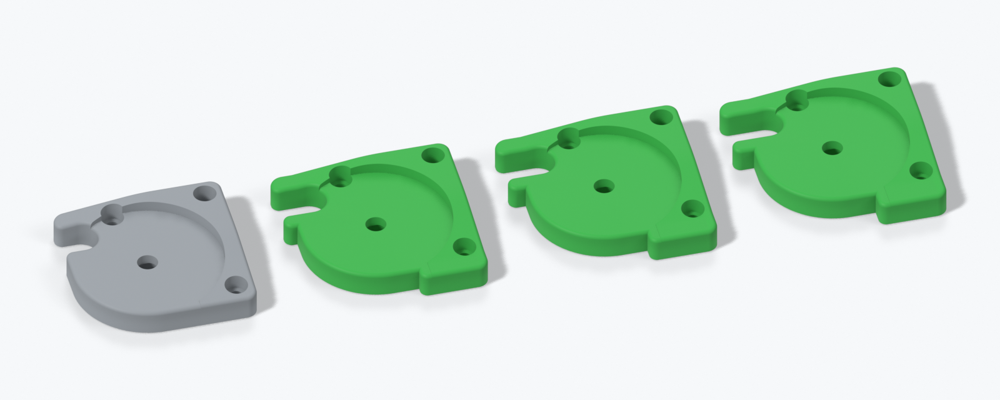
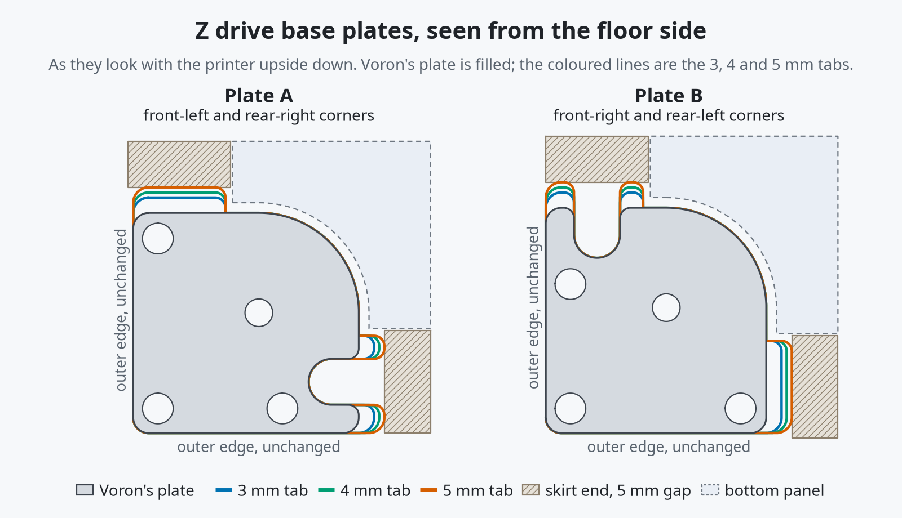

# Extended Z drive base plates for the Voron 2.4r2

Voron's Z drive base plates, the plates under each Z drive that carry the rubber feet, with a
tab 3, 4 or 5 mm long on each of their two inner edges, where the skirts end. They close the
gap between the plate and the ends of the skirts on printers where that gap is wider than Voron
intended, and the bottom panel still fits without any trimming.



This is an unofficial community mod. It is not made, tested or endorsed by Voron Design. It is
a modified copy of Voron Design's `[a]_z_drive_baseplate_a_x2.stl` and
`[a]_z_drive_baseplate_b_x2.stl` from the
[Voron 2.4 repository](https://github.com/VoronDesign/Voron-2), and like them it is licensed
under the GPL-3.0.

**Status:** checked in Voron's 2.4r2 CAD assembly. A physical test on a 350 mm 2.4r2 is in
progress, and this line will say what it found.

## Contents

- [Read this first: measure your gaps](#read-this-first-measure-your-gaps)
- [What changed](#what-changed)
- [Compatibility](#compatibility)
- [What to print](#what-to-print)
- [What you need](#what-you-need)
- [Fitting](#fitting)
- [The bottom panel](#the-bottom-panel)
- [What these plates do not do](#what-these-plates-do-not-do)
- [Rebuilding the files](#rebuilding-the-files)
- [Credits and license](#credits-and-license)

## Read this first: measure your gaps

In Voron's own 3D model of the 2.4r2, the end of each skirt stops **2 mm** from the inner edge
of the base plate, at all four corners. If your skirts sit where Voron puts them, even the
3 mm plate is 1 mm too long and would push against a skirt. These plates are for printers whose
skirts end further away than that, for example because of a different skirt design or a kit's
own parts.

So measure before you print. With the skirts fitted, measure the gap between each inner edge of
each base plate and the end of the skirt beside it, using feeler gauges, the depth rod of a
caliper, or drill bits as gauges. Then, for each corner:

- Choose the size that matches the gap: about 3 mm gap, the 3 mm plate; 4 mm, the 4 mm plate;
  5 mm, the 5 mm plate.
- Both tabs on a plate are the same length, so if a corner's two gaps differ, go by the
  **smaller** one. A plate that is slightly short is fine; one that is too long pushes on
  the skirt.
- If your gaps are smaller than 3 mm, or you want something between the standard sizes, the
  script can make any size from 0.5 to 10 mm (see
  [Rebuilding the files](#rebuilding-the-files)).

## What changed



Each base plate has two **outer** edges, which line up with the outside of the frame and carry
the raised rim around the foot, and two **inner** edges, which face into the printer. Only the
outer part of each inner edge faces a skirt: the skirt is 20 mm deep, so its end covers the
first 19 to 20 mm of the plate's edge, counted from the outside of the printer. The rest of the
inner edge, and the large rounded corner between the two, faces the bottom panel. In these
files:

- Each inner edge gets a **tab** 3, 4 or 5 mm long, as thick as the plate, exactly where the
  skirt end is: 19 mm wide on the edge that faces the side skirt and 18 mm wide on the edge
  that faces the front or rear skirt. Each tab stops 1 mm short of the inside face of its skirt.
- The slot in the side-facing inner edge, under the frame bolt above it, is carried straight
  out through its tab, so it stays open, and its new mouth has rounded corners like Voron's.
- The tabs have Voron's edge shape: a small chamfer on the side that sits against the drive and
  a rounded edge on the floor side. Their joint with Voron's old edge is filled, so there is no
  groove.
- Everything else is Voron's plate unchanged: the rest of both inner edges, the large rounded
  corner, the two outer edges, the three screw holes, the nut pocket, the rim and the seat for
  the foot. The script checks this every time it runs.

The picture draws the skirt ends 5 mm from Voron's plate, as on a printer that needs the 5 mm
plates; in Voron's own model they are 2 mm away.

## Compatibility

- **Voron 2.4r2, any size.** The Z drives and their base plates are the same on the 250, 300
  and 350 mm builds.
- Made from Voron's stock 2.4r2 base plates, and checked in Voron's 2.4r2 assembly at all four
  corners: the tabs reach only the ends of the skirts. The bottom panel keeps the 2 mm clearance
  Voron gave it, and the motors, their pulleys, the bolts and the drive housings are all clear.
- The tabs are placed for Voron's 20 mm deep skirts. If your skirts are a different depth, check
  that the tabs stay within the skirt ends before you fit the bottom panel.
- Not checked on the 2.4r1 or earlier, or with third-party Z drives, feet or skirts.

## What to print

| File | What it is | Corners |
| --- | --- | --- |
| `STLs/[a]_z_drive_baseplate_a_plus3mm_x2.stl` | Plate A, 3 mm tabs | front-left, rear-right |
| `STLs/[a]_z_drive_baseplate_a_plus4mm_x2.stl` | Plate A, 4 mm tabs | front-left, rear-right |
| `STLs/[a]_z_drive_baseplate_a_plus5mm_x2.stl` | Plate A, 5 mm tabs | front-left, rear-right |
| `STLs/[a]_z_drive_baseplate_b_plus3mm_x2.stl` | Plate B, 3 mm tabs | front-right, rear-left |
| `STLs/[a]_z_drive_baseplate_b_plus4mm_x2.stl` | Plate B, 4 mm tabs | front-right, rear-left |
| `STLs/[a]_z_drive_baseplate_b_plus5mm_x2.stl` | Plate B, 5 mm tabs | front-right, rear-left |

Left and right are as seen standing in front of the printer, and A and B go in the same corners
as Voron's own plates. A printer needs two A plates and two B plates. Once you have measured,
print one plate of the right size for each corner; `_x2` in the file names follows Voron's
convention of two per printer. If you have not measured yet, printing two of every file (12
plates) lets every corner take any size.

### Print settings

Voron's standard settings:

- ABS or ASA, as for the rest of the printer. `[a]_` means accent colour, as in Voron's files.
- 0.2 mm layers, 4 walls, 5 top and 5 bottom layers, 40 % infill.
- Print flat, exactly as the file is oriented: the flat side, the one that sits against the
  drive, on the bed, with the rim pointing up. No supports.

## What you need

- No new hardware. Each plate reuses the three screws, the foot, its bolt and its nut from the
  plate it replaces.
- The hex keys that fit those screws and the foot bolt.
- A helper to turn the printer over.

## Fitting

### Before you start

1. Turn the printer off and unplug it.
2. Take off anything loose: the build sheet, spools and tools.
3. With a helper, lay the printer on its back, or turn it upside down, on a soft and clean
   surface, so you can reach the feet. It is heavy and awkward, so do not do this alone. The
   gantry may drift while the printer is on its side; that does no harm, and you will home and
   level it afterwards.

### Swap the plate at one corner

Do one corner at a time, and finish it before you start the next.

1. Undo the bolt through the rubber foot and lift the foot off. The nut it screws into sits in a
   hexagon pocket on the other side of the plate, against the drive. It comes free in the next
   step, so keep hold of it.
2. Take out the three screws that hold the plate to the drive, and lift the plate off.
3. Check the letter: lay the new plate on the old one, rim up on both. The three screw holes and
   the hexagon should line up. If they only line up with one plate turned over, you have the
   other letter.
4. Put the nut into the hexagon pocket on the flat side of the new plate, set the plate on the
   drive with the tabs pointing at the skirt ends, and put the three screws back. They go into
   brass inserts in a printed part, so stop as soon as they are snug.
5. Refit the foot with its bolt.
6. Look at the two tabs. They should come close to the ends of the skirts without pushing on
   them. If a tab pushes a skirt out of line, use the next size down.

### When all four corners are done

1. Stand the printer back on its feet and check it does not rock. If it does, find the foot that
   is not touching and check that plate is seated flat on its drive.
2. Plug it in, then home and level the gantry: `G28`, then `QUAD_GANTRY_LEVEL`, then `G28 Z`.

## The bottom panel

No trimming is needed. In Voron's design the corner cut-outs in the bottom panel follow the
plate's outline with 2 mm to spare, and the panel's edges sit just inside the skirts. The tabs
only grow the plate where the skirts are, and stop 1 mm short of each skirt's inside face, so
the panel keeps all of Voron's 2 mm clearance around the plate and at least 1.4 mm from the end
of each tab.

When the panel goes back on, check that it drops in without touching any plate. If it does
touch, look first at whether a plate is seated square on its drive.

## What these plates do not do

These plates close a gap. They do not hold the frame together. A plate meets the skirt only
edge to edge, so nothing stops a frame bar sliding along its corner post past the plate. If the
bottom frame bars on your printer creep, or the Z belts keep going slack because the frame is
moving, tighten the frame's corner joints; these plates will not fix that.

## Rebuilding the files

The STLs are made by a script from Voron's own base plate files, so anyone can check or change
them. You need Python 3 and [uv](https://docs.astral.sh/uv/). From the repository root:

```sh
python3 CAD/fetch_voron_originals.py
uv run --with numpy==2.5.5 --with manifold3d==3.5.5 python -I CAD/make_baseplates.py
```

The first command downloads Voron's two base plate files from a fixed commit of the Voron-2
repository and checks their SHA-256. The second writes the six STLs into `STLs/`, and checks
each one: none of Voron's plate is removed, nothing is added outside the two tabs, the outer edges
do not move and each tab reaches out by exactly the chosen amount. With the default
sizes the output is byte-for-byte identical to the files in this repository. For other sizes,
add for example `--sizes 1.5,2,2.5`; any size from 0.5 to 10 mm is allowed, but only 3, 4 and
5 mm have been checked in the assembly.

`CAD/STEP_files.zip` holds STEP versions of the six plates for anyone who wants to remix them
in a CAD program. They are converted from the meshes: flat faces are merged into true planes,
but curved faces stay faceted, so the script is the better place to make changes.

## Credits and license

- Original base plate design: [Voron Design](https://vorondesign.com), from
  [VoronDesign/Voron-2](https://github.com/VoronDesign/Voron-2), GPL-3.0.
- Modification: ChanceTheHacker, 2026.

This mod, including the STLs, STEP files and scripts, is licensed under the GNU General Public
License v3.0. See [LICENSE](LICENSE).
